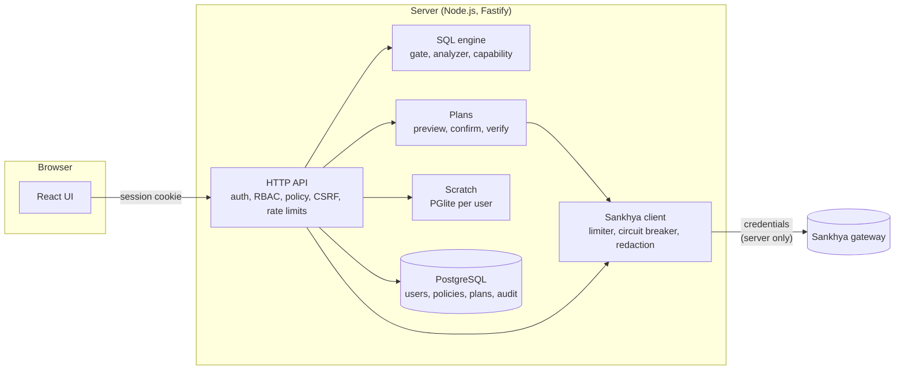

# DB-Sankhya

[](https://github.com/Gustavo-Ale07/db-sankhya/actions/workflows/ci.yml)
[](https://github.com/Gustavo-Ale07/db-sankhya/actions/workflows/codeql.yml)
[](LICENSE)

An independent, security-focused SQL workspace for exploring and carefully changing Sankhya ERP
data through the Sankhya gateway.

**[Leia em português](README.pt-BR.md)**

> DB-Sankhya is an independent project; it is not affiliated with or endorsed by Sankhya, and it
> is not an official Sankhya product. Sankhya names and platform concepts are referenced only for
> compatibility and integration.

## Features

- **SQL editor**: Monaco with completion from the Sankhya data dictionary, run the statement under
  the cursor (`Ctrl+Enter`), several tabs, history and saved queries.
- **Safe reads**: a single `SELECT` in the database's dialect (Oracle or SQL Server) passes a
  lexical gate and an AST allowlist before it reaches the gateway; anything else is refused. See
  the [SQL dialect](docs/sql-dialect.md).
- **Planned writes**: `INSERT` and `UPDATE` of Sankhya tables run only as immutable plans:
  preview (`SIMULATED_PREVIEW`, `IMPACT_ANALYSIS`), typed confirmation, re-authorization, one
  gateway save per row that is never retried, read-back verification (`VERIFIED`,
  `PARTIALLY_VERIFIED`, `UNVERIFIED`, `FAILED`) and audit. Writes are off by default.
- **Policies and approvals**: users, groups and roles over a fixed permission catalog, plus
  policy rules by environment, connection, table and column. `DENY` wins, writes are
  default-deny, and a rule can require a second person's approval. No administrator bypass.
- **Kill switches**: `GLOBAL_WRITE_ENABLED`, `WRITE_TO_SANKHYA` and `SAFE_MODE`, plus a runtime
  switch that stops every planned write and business action without a restart (statements in the
  local scratch database are not covered).
- **Scratch workspace**: private `tmp_` tables per user in an in-memory PGlite, filled from Sankhya
  reads by materialization. Nothing in scratch reaches the ERP.
- **Custom DDL as artifacts**: `CREATE` / `ALTER` / `DROP` of custom-prefix tables (`AD_`) become
  Add-on Studio files; native DDL is never executed.
- **Business actions**: a typed registry of gateway services (today, cancelling a note), behind
  the same plan lifecycle and an explicit allowlist.
- **Audit**: every Sankhya read, plan, approval, verification and administrative change, with an assisted
  rollback plan for verified updates.
- **Mock mode**: a bundled fake gateway with fictitious data, for development, tests and demos.

Each statement maps to a capability: `SUPPORTED`, `SUPPORTED_VIA_GENERATED_ARTIFACT`,
`SCRATCH_ONLY` or `UNSUPPORTED` ([capabilities](docs/capabilities.md)).

## How it works



The browser never talks to Sankhya, and the credentials never leave the server. A write follows
`PARSE → VALIDATE → AUTHORIZE → PLAN → PREVIEW → IMPACT → CONFIRM → RE-AUTHORIZE → EXECUTE →
VERIFY → AUDIT`. See [Architecture](docs/architecture.md).

## Development

```bash
pnpm install
pnpm dev          # API on :3001, web on :5173 (mock Sankhya, in-memory PostgreSQL)
pnpm test
pnpm test:e2e     # after pnpm build
```

No Sankhya account or database server is needed. See [Development](docs/development.md).

## Documentation

| Document                                   | Contents                                                     |
| ------------------------------------------ | ------------------------------------------------------------ |
| [Architecture](docs/architecture.md)       | modules, read path, write lifecycle, approvals, rollback     |
| [Capabilities](docs/capabilities.md)       | what each statement can do and by which route                |
| [Security](docs/security.md)               | threat model, authentication, authorization, policy engine   |
| [Permissions](docs/permissions.md)         | permission reference, seeded roles, where each is checked    |
| [Sankhya](docs/sankhya.md)                 | gateway services, limits, unverified behaviour, environments |
| [Deployment](docs/deployment.md)           | Docker Compose, reverse proxy, enabling writes, hardening    |
| [Operations](docs/operations.md)           | backup and restore, master key, write switches, runbook      |
| [SQL dialect](docs/sql-dialect.md)         | accepted SQL and known refusals                              |
| [Troubleshooting](docs/troubleshooting.md) | startup errors, login, query and write error codes           |
| [Development](docs/development.md)         | local setup, layout, scripts, conventions                    |
| [Decision records](docs/adr/README.md)     | architecture decisions                                       |

## Security

- Gateway credentials stay on the server, encrypted at rest, and are redacted from responses,
  logs, history and audit.
- Argon2id passwords, hashed session tokens, `__Host-` cookies, account lockout, rate limits, CSRF
  origin check, strict CSP.
- Configuration is validated at boot, and production refuses weak or placeholder secrets.
- No production credentials or company data belong in this repository; a private deployment
  supplies its own through the environment.

Read the [threat model](docs/security.md). To report a vulnerability, see
[SECURITY.md](SECURITY.md).

## License

[MIT](LICENSE). Maintained by [Gustavo-Ale07](https://github.com/Gustavo-Ale07).
