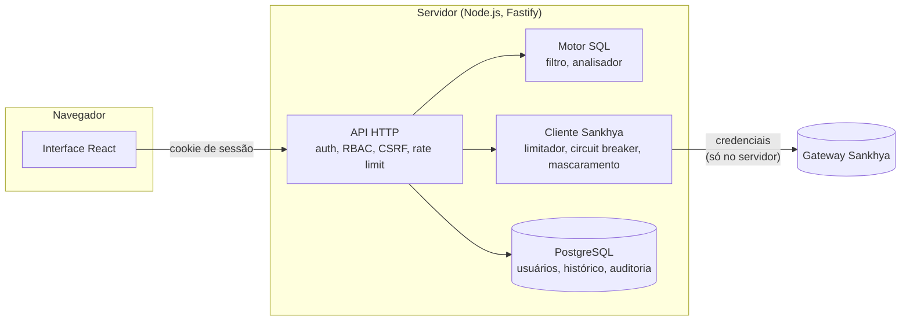

# DB-Sankhya

[](https://github.com/Gustavo-Ale07/db-sankhya/actions/workflows/ci.yml)
[](https://github.com/Gustavo-Ale07/db-sankhya/actions/workflows/codeql.yml)
[](LICENSE)

Interface independente, com foco em segurança, para explorar dados do Sankhya ERP com SQL
através do gateway do Sankhya.

**[Read in English](README.md)**

> **Status:** em desenvolvimento ativo. O projeto está sendo adaptado a partir de um explorador
> de banco de dados existente. Hoje há leitura (`SELECT`) pelo gateway; escritas ainda não estão
> disponíveis.

## O que funciona hoje

- **Editor SQL**: Monaco, com autocompletar a partir do dicionário de dados do Sankhya, execução
  da instrução sob o cursor (`Ctrl+Enter`) e várias abas.
- **Árvore de tabelas** carregada do dicionário de dados da conexão padrão.
- **Leitura segura**: um único `SELECT`, no dialeto do banco do Sankhya (Oracle ou SQL Server),
  passa por um filtro léxico e por uma allowlist de AST antes de ir ao gateway; o resto é
  recusado. Veja o [dialeto SQL](docs/sql-dialect.md) (em inglês).
- **Escritas recusadas**: `INSERT`, `UPDATE`, `DELETE` e DDL respondem `SQL_UNSUPPORTED` e ficam
  registrados na auditoria.
- **Resultados**: grade virtualizada, visão JSON e exportação em CSV/JSON.
- **Histórico, consultas salvas, usuários, grupos e papéis com permissões, e log de auditoria.**
- **Modo mock**: um gateway Sankhya falso, em processo, com dados fictícios.

## Como funciona



O navegador nunca fala com o Sankhya, e as credenciais nunca saem do servidor. Mais detalhes em
[Arquitetura](docs/architecture.md) (em inglês).

## Desenvolvimento

```bash
pnpm install
pnpm dev          # API em :3001, web em :5173 (Sankhya mock, PostgreSQL em memória)
pnpm test
pnpm test:e2e     # depois de pnpm build
```

Não é preciso conta no Sankhya nem servidor de banco. Veja [Development](docs/development.md) e
[Deployment](docs/deployment.md) (em inglês).

## Segurança

- Credenciais do gateway ficam no servidor e são mascaradas em respostas, logs, histórico e
  auditoria.
- Senhas com Argon2id, tokens de sessão armazenados como hash, cookies `__Host-`, bloqueio de
  conta, rate limit, verificação de origem contra CSRF, CSP restritiva.
- A configuração é validada no boot, e a produção recusa segredos fracos.

Leia o [modelo de ameaças](docs/security.md). Para reportar uma vulnerabilidade, veja o
[SECURITY.md](SECURITY.md).

## Aviso

DB-Sankhya é um projeto independente e não é um produto oficial da Sankhya.

## Licença

[MIT](LICENSE)
