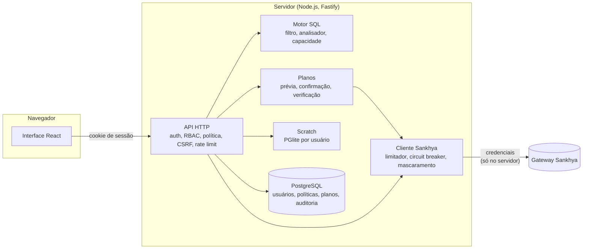

# DB-Sankhya

[](https://github.com/Gustavo-Ale07/db-sankhya/actions/workflows/ci.yml)
[](https://github.com/Gustavo-Ale07/db-sankhya/actions/workflows/codeql.yml)
[](LICENSE)

Um espaço de trabalho SQL independente, com foco em segurança, para explorar e alterar com
cuidado dados do Sankhya ERP através do gateway do Sankhya.

**[Read in English](README.md)**

> O DB-Sankhya é um projeto independente; não é afiliado nem endossado pela Sankhya, e não é um
> produto oficial da Sankhya. Nomes e conceitos da plataforma Sankhya são citados apenas para fins
> de compatibilidade e integração.

## Recursos

- **Editor SQL**: Monaco com autocompletar a partir do dicionário de dados do Sankhya, execução
  da instrução sob o cursor (`Ctrl+Enter`), várias abas, histórico e consultas salvas.
- **Leitura segura**: um único `SELECT` no dialeto do banco (Oracle ou SQL Server) passa por um
  filtro léxico e por uma allowlist de AST antes de chegar ao gateway; o resto é recusado. Veja o
  [dialeto SQL](docs/sql-dialect.md).
- **Escritas planejadas**: `INSERT` e `UPDATE` em tabelas do Sankhya rodam só como planos
  imutáveis: prévia (`SIMULATED_PREVIEW`, `IMPACT_ANALYSIS`), confirmação digitada,
  reautorização, um salvamento por linha no gateway, nunca repetido, verificação por releitura
  (`VERIFIED`, `PARTIALLY_VERIFIED`, `UNVERIFIED`, `FAILED`) e auditoria. As escritas vêm
  desligadas.
- **Políticas e aprovações**: usuários, grupos e papéis sobre um catálogo fixo de permissões, mais
  regras de política por ambiente, conexão, tabela e coluna. `DENY` prevalece, escritas são negadas
  por padrão, e uma regra pode exigir a aprovação de uma segunda pessoa. Administrador não tem
  atalho.
- **Chaves de emergência**: `GLOBAL_WRITE_ENABLED`, `WRITE_TO_SANKHYA` e `SAFE_MODE`, mais uma
  chave em tempo de execução que para todas as escritas planejadas e ações de negócio sem reiniciar
  (instruções executadas diretamente no editor de scratch (`/api/scratch/exec`) e a materialização
  não são cobertas).
- **Área de rascunho (scratch)**: tabelas `tmp_` privadas por usuário num PGlite em memória,
  preenchidas a partir de leituras do Sankhya por materialização. Nada do scratch chega ao ERP.
- **DDL customizado como artefato**: `CREATE` / `ALTER` / `DROP` de tabelas com prefixo
  customizado (`AD_`) viram arquivos do Add-on Studio; DDL nativo nunca é executado.
- **Ações de negócio**: um registro tipado de serviços do gateway (hoje, cancelar uma nota), com o
  mesmo ciclo de plano e uma lista explícita de liberação.
- **Auditoria**: toda leitura no Sankhya, plano, aprovação, verificação e mudança administrativa,
  com um plano de rollback assistido para atualizações verificadas.
- **Modo mock**: um gateway falso embutido, com dados fictícios, para desenvolvimento, testes e
  demonstração.

Cada instrução corresponde a uma capacidade: `SUPPORTED`, `SUPPORTED_VIA_GENERATED_ARTIFACT`,
`SCRATCH_ONLY` ou `UNSUPPORTED` ([capacidades](docs/capabilities.md)).

## Como funciona



O navegador nunca fala com o Sankhya, e as credenciais nunca saem do servidor. Uma escrita segue
`PARSE → VALIDATE → AUTHORIZE → PLAN → PREVIEW → IMPACT → CONFIRM → RE-AUTHORIZE → EXECUTE →
VERIFY → AUDIT`. Veja a [Arquitetura](docs/architecture.md).

## Desenvolvimento

```bash
pnpm install
pnpm dev          # API em :3001, web em :5173 (Sankhya mock, PostgreSQL em memória)
pnpm test
pnpm test:e2e     # depois de pnpm build
```

Não é preciso conta no Sankhya nem servidor de banco. Veja [Development](docs/development.md).

## Documentação

A documentação técnica está em inglês.

| Documento                                  | Conteúdo                                                        |
| ------------------------------------------ | --------------------------------------------------------------- |
| [Architecture](docs/architecture.md)       | módulos, leitura, ciclo das escritas, aprovações, rollback      |
| [Capabilities](docs/capabilities.md)       | o que cada instrução pode fazer e por qual rota                 |
| [Security](docs/security.md)               | modelo de ameaças, autenticação, autorização, motor de política |
| [Permissions](docs/permissions.md)         | referência de permissões, papéis iniciais, onde são checadas    |
| [Sankhya](docs/sankhya.md)                 | serviços do gateway, limites, pontos não verificados, ambientes |
| [Deployment](docs/deployment.md)           | Docker Compose, proxy reverso, liberar escritas, endurecimento  |
| [Operations](docs/operations.md)           | backup e restauração, chave mestra, chaves de escrita, rotina   |
| [SQL dialect](docs/sql-dialect.md)         | SQL aceito e recusas conhecidas                                 |
| [Troubleshooting](docs/troubleshooting.md) | erros de inicialização, login, consultas e escritas             |
| [Development](docs/development.md)         | ambiente local, estrutura, scripts, convenções                  |
| [Decision records](docs/adr/README.md)     | decisões de arquitetura                                         |

## Segurança

- As credenciais do gateway ficam no servidor, cifradas em repouso, e são mascaradas em
  respostas, logs, histórico e auditoria.
- Senhas com Argon2id, tokens de sessão armazenados como hash, cookies `__Host-`, bloqueio de
  conta, rate limit, verificação de origem contra CSRF, CSP restritiva.
- A configuração é validada no boot, e a produção recusa segredos fracos ou de exemplo.
- Nenhuma credencial de produção ou dado de empresa pertence a este repositório; uma instalação
  privada fornece os seus pelo ambiente.

Leia o [modelo de ameaças](docs/security.md). Para reportar uma vulnerabilidade, veja o
[SECURITY.md](SECURITY.md).

## Licença

[MIT](LICENSE). Mantido por [Gustavo-Ale07](https://github.com/Gustavo-Ale07).
