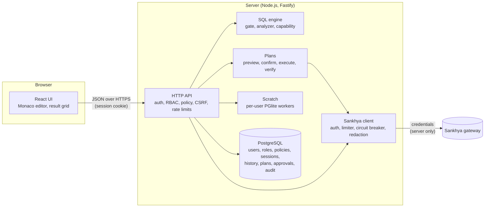
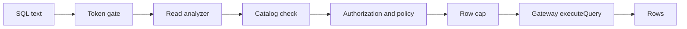

# Architecture

DB-Sankhya is a SQL workspace over the Sankhya ERP **gateway**. The browser never talks to
Sankhya: the server holds the gateway credentials, checks every statement and sends only what it
has proved it can carry out safely. Reads run directly. Writes run only as immutable, previewed,
confirmed and audited plans (see [Writes](#writes)). Native DDL is never executed.



Gateway credentials come from the environment (`SANKHYA_*`, the default connection) or from
connections registered in the admin panel, stored encrypted with `ENCRYPTION_KEY`. They are
redacted from every log, history row and audit record.

## Modules

| Module                    | Responsibility                                                                                                     |
| ------------------------- | ------------------------------------------------------------------------------------------------------------------ |
| `packages/sql-engine`     | Token gate, read analyzer, capability resolution, write planning, DDL artifact generation, scratch guard.          |
| `packages/sankhya-client` | HTTP transport, token handling, rate and concurrency limits, circuit breaker, retries for idempotent calls only.   |
| `packages/shared`         | Permission catalog, policy engine, error codes and the API contracts shared by the server and the UI.              |
| `packages/database`       | Drizzle schema and versioned SQL migrations for PostgreSQL (PGlite in memory for development and tests).           |
| `apps/api`                | Fastify server: sessions, RBAC, policies, plans, approvals, scratch, audit, history, saved queries, static web UI. |
| `apps/web`                | React 19 + Vite UI: schema tree, tabs, Monaco with completion, virtualized grid, write dialog, admin pages.        |

Every statement is first resolved to a **capability** (`SUPPORTED`,
`SUPPORTED_VIA_GENERATED_ARTIFACT`, `SCRATCH_ONLY` or `UNSUPPORTED`) and a route. See
[capabilities.md](capabilities.md) for the full matrix.

## Read path



| Stage         | Module                                     | Responsibility                                                                                                    |
| ------------- | ------------------------------------------ | ----------------------------------------------------------------------------------------------------------------- |
| Token gate    | `packages/sql-engine/src/gate.ts`          | Lexical, fail-closed: refuses comments, several statements, write/DDL/procedural keywords, db links, sequences.   |
| Read analyzer | `packages/sql-engine/src/read-analyzer.ts` | Parses the statement in the connection's dialect (Oracle or SQL Server) and allows only a known set of AST nodes. |
| Catalog       | `apps/api/src/services/metadata.ts`        | Data dictionary discovered from the gateway and cached; every table in the read must exist in it.                 |
| Read executor | `apps/api/src/services/read-executor.ts`   | Runs the steps above, applies the row cap and sends the read to the gateway.                                      |

Anything the gate or the analyzer does not recognise is refused with `SQL_FORBIDDEN`; it is
never sent to the gateway. The row cap is the smallest of `SANKHYA_MAX_ROWS` and the policy's
`maxReadRows`; `truncated: true` tells the UI the result was cut.

`packages/sql-engine` also keeps a small in-memory evaluator (`src/local/evaluate.ts`,
`evaluateSelect`) that runs a parsed SELECT over rows already in memory. It is not on the
gateway read path.

## Writes

`POST /api/query` never executes a mutation. An `INSERT`, `UPDATE` or `DELETE` sent there is
refused with `SQL_UNSUPPORTED` and a pointer to `POST /api/query/preview`; other mutations (DDL and the
like) are refused outright. Both are audited as `write.denied`. The legacy
`POST /api/query/confirm` route is always refused.

A write goes through two calls and eleven steps (`apps/api/src/services/mutations.ts`):

```text
prepare:  PARSE → VALIDATE → AUTHORIZE → PLAN → PREVIEW → IMPACT
execute:  CONFIRM → RE-AUTHORIZE → EXECUTE → VERIFY → AUDIT
```

### Prepare (`POST /api/query/preview`)

Body: `{ sql, connectionId? }`. Nothing is written; the only gateway call is the read of the
current rows.

1. **PARSE / VALIDATE**: the statement is parsed in the connection's dialect. An `INSERT` needs an
   explicit column list and one `VALUES` row (`INSERT … SELECT` is refused); aggregates and boolean
   literals are refused in a write.
2. **AUTHORIZE**: the user needs the permission for the statement (`DATA.INSERT`, `DATA.UPDATE`,
   `DATA.DELETE`, or `TEMP.WRITE` for scratch tables) and access to the connection. The capability
   must be `SANKHYA_SAVE` (or `SCRATCH` for `tmp_` tables); otherwise the request fails with
   `OPERATION_NOT_SUPPORTED` and the reason. The policy engine then decides (see
   [security.md](security.md#policy-engine)); a denial is `FORBIDDEN`, an `UPDATE` without `WHERE`
   is `WHERE_REQUIRED` unless an override rule covers it.
3. **PLAN**: the target rows are resolved by primary key. More rows than the policy's
   `maxWriteRows` is `WRITE_ROW_LIMIT_EXCEEDED`. The plan (statement,
   targets, before values, intended changes, policy version, limits) is stored immutably with a
   hash, and a token bound to the plan, its hash and the session is issued.
4. **PREVIEW / IMPACT**: the response carries the before and after rows with the preview kind:

   | Label                   | Used for                                       |
   | ----------------------- | ---------------------------------------------- |
   | `IMPACT_ANALYSIS`       | the real target rows of a Sankhya `UPDATE`     |
   | `SIMULATED_PREVIEW`     | a Sankhya `INSERT`, and the "after" of updates |
   | `TRANSACTIONAL_DRY_RUN` | scratch writes, run and rolled back in PGlite  |

   It also says whether execution is currently possible:
   `execution { available, safeMode, globalWriteEnabled, writeToSankhya }`, and which confirmation
   is required.

### Execute (`POST /api/query/execute`)

Body: `{ planId, token, idempotencyKey, strongConfirmation? }`.

5. **CONFIRM**: the plan is consumed exactly once (a single conditional update). The token must
   match the plan and the session; an expired plan is `CONFIRMATION_EXPIRED` (410), a used one
   `CONFIRMATION_USED` (409). When the plan needs strong confirmation the user must type the exact
   phrase `<ENVIRONMENT> <ACTION> <N> <ENTITY>`, for example `PRODUCTION UPDATE 3 TGFPAR`; it is
   required for every `PRODUCTION` write. A repeat with the same `idempotencyKey` returns the
   stored result instead of running again. A plan that needs approval is consumed only through
   its approval (see [Approvals](#approvals)).
6. **RE-AUTHORIZE**: the policy is evaluated again. The plan is refused if the policy version
   changed, if the new limits are stricter, or if the capability changed. The target rows are read
   again; if they no longer match the preview the plan fails with `TARGETS_CHANGED`. Then the
   [kill switches](#kill-switches) are checked.
7. **EXECUTE**: one `DatasetSP.save` call per target row, each sent exactly once and **never
   retried**. Before every call the switches and the policy version are checked again, so an
   emergency stop halts a running plan. After a definite failure or a stop, the remaining rows are
   reported as not attempted. A timeout or an ambiguous answer is `WRITE_OUTCOME_UNKNOWN`: the
   change may or may not have been applied.
8. **VERIFY**: each changed row is read back by key and compared with the intended values.
9. **AUDIT**: `PLAN_EXECUTED` and `VERIFICATION` events are written with the before and after
   snapshots. If the audit itself fails after a save, the result is `WRITE_OUTCOME_UNKNOWN`.

The result label is one of:

| Verification         | Meaning                                                                      |
| -------------------- | ---------------------------------------------------------------------------- |
| `VERIFIED`           | every step ran and every row read back holds the intended values             |
| `PARTIALLY_VERIFIED` | some steps were verified, others could not be (not attempted or unknown)     |
| `UNVERIFIED`         | nothing could be verified (for example, no key to read an inserted row back) |
| `FAILED`             | a row read back does not hold the intended values                            |

An `INSERT` is read back by the key the gateway returned in the save result; only the inserted
columns are compared. Without a complete key the step stays `UNVERIFIED`. The label applies to
the whole run, not to each row; per-step outcomes show which rows were saved. A gateway error
stops the run, which is then labelled by what could be read back (`UNVERIFIED` or
`PARTIALLY_VERIFIED`); the error itself is in the step outcome. When the gateway's answer is
lost, the row is still read back: a match is labelled `PARTIALLY_VERIFIED`, not `VERIFIED`,
because the save was never confirmed.

### Kill switches

Three switches are checked at re-authorization and again before every gateway save. A switch that
is off refuses the plan with `READ_ONLY_MODE` ("Writes are disabled (<switch>)"):

| Switch                 | Default | Effect when off / on                                                                 |
| ---------------------- | ------- | ------------------------------------------------------------------------------------ |
| `GLOBAL_WRITE_ENABLED` | `false` | off: no planned write or business action. Effective value = environment AND runtime. |
| `WRITE_TO_SANKHYA`     | `false` | off: no write to Sankhya tables (scratch writes still run).                          |
| `SAFE_MODE`            | `true`  | on: no write to a connection whose environment is `PRODUCTION`.                      |

`GLOBAL_WRITE_ENABLED` has a runtime half stored in the database, changed by an administrator with
`ADMIN.SECURITY` on the **Segurança** page or `PUT /api/admin/security` (`security.update` audit
event). The runtime switch can only turn writes **off**: when the environment value is `false` it
cannot enable them. If the stored value cannot be read, writes are refused. `GET /api/status`
shows `writes.globalWrite { env, runtime, effective }` with the other switches.

### Approvals

A policy rule can set `requireApproval` (it is also forced when an `ALLOW` rule overrides the
`WHERE` requirement). Then the owner asks for approval with `POST /api/approvals { planId }`
instead of executing. A second person with `APPROVAL.DECIDE` decides in **Aprovações**
(`GET /api/approvals/pending`, `POST /api/approvals/:id/decision` with
`{ decision: "APPROVE" | "REJECT", reason }`):

- the approver cannot be the requester, must be active, must hold the plan's permissions and must
  be allowed by the current policy;
- the approval is bound to the plan hash and expires with the plan (`APPROVAL_TTL_MINUTES`);
- a rejection invalidates the plan;
- an approved plan is then executed by its owner with the same execute call, and goes through
  every step above.

### Assisted rollback

On **Auditoria**, a user with `AUDIT.READ` can ask for a rollback plan of an executed write
(`POST /api/audit/:id/rollback-plan`). It is offered only for a fully `VERIFIED` `UPDATE` of a
Sankhya table whose snapshots are complete. It is refused when snapshots were disabled
(`auditSnapshots` false), redacted or clipped, or when a value cannot be written back exactly.
The server builds `UPDATE` statements that restore the previous values and prepares the first statement as a normal plan under the caller's own permissions and
policy (`rollback.planned` audit event). Conflicts (rows that changed or no longer exist) are
checked only for that prepared first statement. It is labelled "assisted rollback — requires new preview
and confirmation": nothing is reverted until that plan is confirmed and executed like any other
write.

### Business actions

Besides the dataset save, the API can call only the gateway services listed in a typed registry
(`apps/api/src/services/business-actions.ts`). Each entry declares its gateway module, the
permission it needs (`SANKHYA.BUSINESS_ACTION.EXECUTE`), the one entity it changes, a zod schema
for its input, the key of the row it changes, and the values that row must hold afterwards. There
is no generic "call any service" endpoint. The registry holds one action today,
`CACSP.cancelarNota` (cancel a note in `TGFCAB`, input `{ nunota, justificativa }`). Actions are
available through the API only; the web UI has no screen for them.

- `POST /api/actions/:id/prepare` with `{ "input": { ... }, "connectionId"?: "..." }` validates
  the input, evaluates the policy with `entities = [the action's entity]`, reads the real row
  (`IMPACT_ANALYSIS`) and returns the expected change (`SIMULATED_PREVIEW`) plus a plan token. An
  unknown action id is `404`.
- `POST /api/actions/:id/execute` with `{ planId, token, idempotencyKey, strongConfirmation? }`
  runs the plan through the same lifecycle as a SQL write: confirmation (or approval),
  re-authorization, kill switches, one call that is never retried, read-back by key (`VERIFIED`
  only when the row holds the expected values) and audit. An action plan cannot be executed
  through `/api/query/execute`, nor a SQL plan through an action route.
- A row already in the target state is refused at preview: reading it back would prove nothing.
- On a `live` connection an action is disabled (`OPERATION_NOT_SUPPORTED`) unless its id is listed
  in `BUSINESS_ACTIONS_ENABLED` (empty by default). Mock connections run every registered action.

The request bodies in the registry were validated only against the bundled gateway mock. See
[sankhya.md](sankhya.md#business-actions) before enabling one on a live connection.

## Scratch workspace

Each user gets a private in-memory PostgreSQL (PGlite) running in a worker thread, for `tmp_`
tables only. `POST /api/scratch/exec` runs scratch statements directly (with the `TEMP.*`
permissions), `GET /api/scratch/tables` lists them, and `POST /api/scratch/materialize` copies the
result of a Sankhya read into a `tmp_` table. Workspaces are capped in number, size, tables, rows
and statement time, and are dropped after `SCRATCH_TTL_MINUTES` of inactivity; a statement that
exceeds its time limit terminates the worker and resets the workspace. Nothing in scratch reaches
the ERP. See [ADR 0011](adr/0011-scratch-pglite.md).

## Custom DDL artifacts

`CREATE`, `ALTER` and `DROP` of a table whose name starts with a `CUSTOM_TABLE_PREFIXES` prefix
(default `AD_`) are turned into Add-on Studio files by `POST /api/ddl/artifact` (AutoDDL
`<TABLE>.xml` and/or dbscript `V<n>.xml`). They are never executed; an administrator deploys them
through the ERP's own tooling. A change the dictionary cannot prove safe needs the typed
confirmation `DESTRUCTIVE <TABLE>`. See [ADR 0012](adr/0012-ddl-as-artifacts.md).

## Persistence

PostgreSQL stores application data: users (Argon2id hashes), sessions (hashed tokens), roles,
groups and policy rules, query history, saved queries, registered connections (secrets
encrypted), the cached data dictionary, plans and approvals, runtime settings (the write switch)
and the audit log. ERP rows are not stored, apart from the before and after snapshots of the rows
a plan changes. Migrations are versioned in `packages/database/migrations` and applied on boot.

## Deployment shape

A single container serves the API and the built web UI on one origin (no CORS), behind a reverse
proxy that terminates TLS. PostgreSQL runs on an internal Docker network with no published port.
See [deployment.md](deployment.md) and [operations.md](operations.md).
