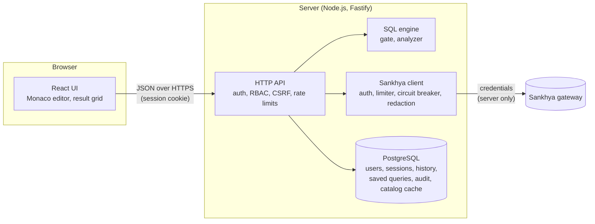
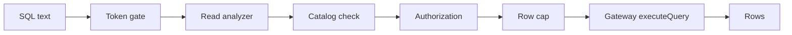

# Architecture

DB-Sankhya is a SQL workspace over the Sankhya ERP **gateway**. The browser never talks to
Sankhya: the server holds the gateway credentials, checks every statement and sends only reads
it has proved safe. Mutations are not available yet; every mutation entry point fails closed
(see [Writes](#writes)).

Gateway credentials come from the environment (`SANKHYA_*`, the default connection) or from
connections registered in the admin panel, stored encrypted with `ENCRYPTION_KEY`. They are
redacted from every log, history row and audit record.

## Read path

| Stage          | Module                                     | Responsibility                                                                                                    |
| -------------- | ------------------------------------------ | ----------------------------------------------------------------------------------------------------------------- |
| Token gate     | `packages/sql-engine/src/gate.ts`          | Lexical, fail-closed: refuses comments, several statements, write/DDL/procedural keywords, db links, sequences.   |
| Read analyzer  | `packages/sql-engine/src/read-analyzer.ts` | Parses the statement in the connection's dialect (Oracle or SQL Server) and allows only a known set of AST nodes. |
| Catalog        | `apps/api/src/services/metadata.ts`        | Data dictionary discovered from the gateway and cached; every table in the read must exist in it.                 |
| Read executor  | `apps/api/src/services/read-executor.ts`   | Runs the steps above, applies the row cap and sends the read to the gateway.                                      |
| Sankhya client | `packages/sankhya-client`                  | HTTP transport, token handling, rate and concurrency limits, circuit breaker, retries for idempotent calls only.  |
| API            | `apps/api`                                 | Fastify server: sessions, RBAC, CSRF, history, saved queries, audit, static web UI.                               |
| Web            | `apps/web`                                 | React 19 + Vite UI: schema tree from the catalog, tabs, Monaco with completion, virtualized grid, admin pages.    |
| Database       | `packages/database`                        | Drizzle schema and versioned SQL migrations for PostgreSQL (PGlite in memory for development and tests).          |

Anything the gate or the analyzer does not recognise is refused with `SQL_FORBIDDEN`; it is
never sent to the gateway. The server caps the rows it returns (`truncated: true` tells the UI
the result was cut).

`packages/sql-engine` also keeps a small in-memory evaluator (`src/local/evaluate.ts`,
`evaluateSelect`) that runs a parsed SELECT over rows already in memory. It is not on the
gateway read path.

## Writes

Mutations (INSERT, UPDATE, DELETE, DDL) are **not available yet**. `POST /api/query` and
`POST /api/query/confirm` refuse them with `SQL_UNSUPPORTED` ("Mutations are not available
yet.") and record a `write.denied` audit event. `SAFE_MODE`, `GLOBAL_WRITE_ENABLED` and
`WRITE_TO_SANKHYA` are kept as kill switches for the future write path; turning them on does not
enable writes today.

## Persistence

PostgreSQL stores application data: users (Argon2id hashes), sessions (hashed tokens), query
history, saved queries, registered connections (secrets encrypted), the cached data dictionary
and the audit log. Migrations are generated by drizzle-kit, versioned in
`packages/database/migrations` and applied on boot.

## Deployment shape

A single container serves the API and the built web UI on one origin (no CORS), behind a reverse
proxy that terminates TLS. PostgreSQL runs on an internal Docker network with no published port.
See [deployment.md](deployment.md).
